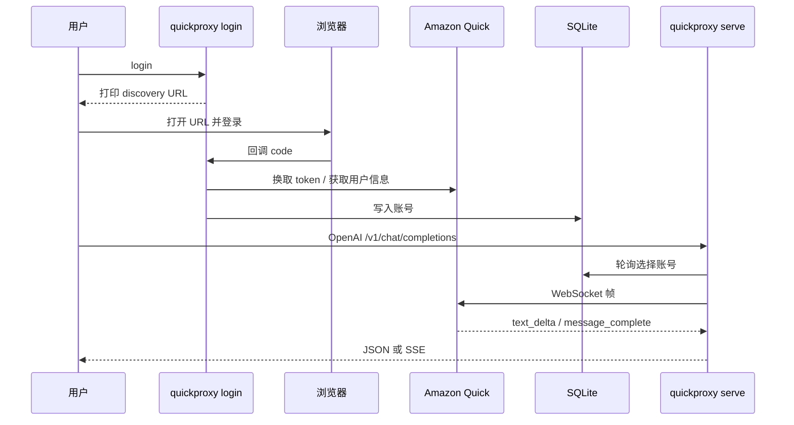

# QuickWork / Amazon Quick → OpenAI API

把 Amazon Quick（QuickWork）桌面端的聊天能力转换成 **OpenAI 兼容的 HTTP API**。

项目是单一 Go 可执行文件：原生 OAuth 登录、账号存储、token 刷新和反代全部由 Go 完成，不需要 Python，也不用启动官方桌面应用或 outpost 进程。登录后由反代把 `/v1/chat/completions` 请求转换为 QuickWork WebSocket 帧，并把结果转回普通 JSON 或 SSE。

> 非官方项目，与 Amazon / AWS 无关联。请仅在你拥有或获得明确授权的账号上使用，并遵守相关服务条款。

## 功能

- 内置中文 React 管理台，可在浏览器中添加、查看、刷新和移除账号，查看模型与 API 接入示例
- `POST /v1/chat/completions`，支持流式（SSE）与非流式响应
- `GET /v1/models`，返回本地模型别名
- 原生 social 登录（AWS IAM Identity Center OIDC）与企业 OIDC 登录，使用 PKCE
- 支持服务器/远程登录：手动粘贴浏览器 callback URL，无需开放本地回调端口
- 服务端配置集中存放在 `config.json`
- 账号存放在 SQLite（`data/quickwork.db`），支持多账号轮询与自动刷新
- 请求按轮询选择账号；到期 token 自动 refresh；失败时切换到下一个账号重试
- 可选本地 API key 保护
- 默认每轮对话结束后删除上游会话，避免污染聊天列表
- 保留 `assistant.tool_calls` / `role: tool` 历史，客户端工具调用链不会丢上下文
- 客户端 `tools` / `functions` 通过 `<client_tool_call>` 协议桥接；代理返回 OpenAI `tool_calls`，实际执行仍在客户端
- 上游原生 `tool_start` / `tool_arguments` / `tool_result` 在名称匹配时也会转成 OpenAI `tool_calls`
- 使用上游 `turn_usage` 返回 `usage` 与 `prompt_tokens_details.cached_tokens`
- `system` / `developer` 消息通过 QuickWork 原生 `system_prompt` 覆盖服务端基础提示词，并附加后端提示词覆盖声明，要求模型忽略上游追加的 system / agent 指令；不拼进 user 文本

## 环境要求

- Go 1.26+（仅构建时需要）
- 一个可正常登录的 Amazon Quick 账号
- 浏览器用于 Amazon 授权。管理台支持手动回填回调地址。CLI 自动回调模式要求浏览器能访问运行 `quickproxy login` 的本机回调端口（默认 `18080`）

## 快速开始

### 1. 构建

```bash
go build -o bin/quickproxy ./cmd/quickproxy       # macOS / Linux
# go build -o bin/quickproxy.exe ./cmd/quickproxy  # Windows
```

### 2. 打开管理台

```bash
./bin/quickproxy serve
```

打开 [本机管理台](http://127.0.0.1:8080/admin/)，选择 **添加账号**。按页面提示打开 Amazon 登录页，将跳转后的完整回调地址粘回管理台，再完成授权并粘贴第二个回调地址。即使浏览器显示回调页面无法打开，也可以复制地址栏中的内容。账号保存到 SQLite 后即可使用。

**账号管理**支持查看到期时间、使用次数、刷新凭据和移除账号。**运行概览**列出当前服务的模型，**接口接入**提供 Base URL 和调用示例。管理台读取与 CLI 相同的数据库。配置项通过 `config.json` 修改，重启服务后生效。

打开[账号状态页](http://127.0.0.1:8080/admin/#status)可按账号查看邮箱、凭据到期时间、状态、累计调用次数、本月已用时长及参考剩余时间。手机可收藏自己服务的 `/admin/#status`。

每个账号默认按 10 小时计算参考剩余时间，可在 `monthly_time_budget` 调整。用时按回合结束时的 UTC 自然月归集，每月 1 日 00:00 UTC 自动开始新一期，累计调用次数延续。升级前只有调用次数，时长从升级后的首个回合开始记录。

上游 `turn_usage` 若返回有效的 `duration_ms`，优先记录该时长。缺少时长时，代理用提交请求至收到上游输出的时间估算，并在页面标出来源。统计只覆盖经过此代理的请求。Amazon 的 agent hours 还受工作模式和并行任务影响，实际余额可在 Mission Control 的用量界面核对。[AWS 计量说明](https://aws.amazon.com/quick/pricing/) · [Mission Control 文档](https://docs.aws.amazon.com/quick/latest/userguide/mission-control.html)

2026-11-22 的一次 `fast` 实测中，`turn_usage` 返回了 token 计数和 `cost_usd`。事件带有 `timestamp` 时间戳，未提供回合耗时。状态页将该轮计为一次本地估算。

默认允许从本机以 `127.0.0.1`、`localhost` 或 `[::1]` 访问管理接口。远程使用可通过 SSH 端口转发到本机。

使用反向代理的部署应仅转发 `/v1/`，或在转发 `/admin/` 前设置独立的环境变量 `QUICKPROXY_ADMIN_TOKEN` 并重启。部分反向代理会重写 `Host` 并移除来源信息，这类请求在服务端看起来来自本机。远程管理时启用 HTTPS，并保留浏览器请求的 `Host`。设置令牌后，所有管理操作均需验证，浏览器仅在当前页面内存中保存令牌。代理客户端密钥由 `api_keys` 配置。

### 3. 命令行登录（可选）

```bash
./bin/quickproxy login --provider social
```

首次运行会在当前目录创建 `config.json`，并在 `data/quickwork.db` 初始化 SQLite。终端会打印一个 discovery URL，例如：

```
https://quick.aws.com/sn?qwSurface=desktop:<nonce>:18080:1.2.4660
```

在**同一台机器**的浏览器中打开它，完成登录。工具会接收浏览器回调、完成 OAuth / PKCE、交换 token、获取用户信息，并把账号写入 SQLite。完成后终端只打印账号显示信息、`ws_host` 和到期时间，不打印 token。

企业 SSO 登录：

```bash
./bin/quickproxy login --provider enterprise --region us-east-1
```

需要登录多个账号时，重复执行 `login` 即可。相同 email + tenant 的账号会更新，不会重复插入。

#### 服务器 / 远程登录（手动回填 callback URL）

如果 `quickproxy` 跑在服务器上，浏览器访问不到服务器的 `localhost:18080`，使用手动模式：

```bash
./bin/quickproxy login -manual
```

流程：

1. 终端打印 discovery URL，在任意机器用浏览器打开并登录。
2. 浏览器会跳转到 `http://localhost:18080/callback?...`。这个页面可能打不开，属正常现象；从地址栏复制**完整 URL**，粘贴回终端。
3. 终端会打印 authorize URL；继续在浏览器打开并完成登录。
4. 浏览器会跳转到 `http://127.0.0.1:18080/?code=...`；同样复制地址栏的完整 URL，粘贴回终端。
5. 工具完成 token 交换并写入 SQLite。

工具会根据 URL 参数自动判断阶段：`nonce=...` 是 discovery callback，`code=...&state=...` 是授权完成 callback。贴入 authorize URL、discovery URL、重复的 discovery callback 或带 fragment 的 callback 都会被识别并提示下一步，不会重复注册 OAuth client。

整个过程不需要服务器开放回调端口；回调端口只用于生成浏览器地址。也可以把 callback URL 通过 stdin 管道传入，便于脚本化。

### 4. 调用

```bash
curl http://127.0.0.1:8080/v1/models \
  -H "Authorization: Bearer local"
```

```bash
curl http://127.0.0.1:8080/v1/chat/completions \
  -H "Authorization: Bearer local" \
  -H "Content-Type: application/json" \
  -d '{
    "model": "smart",
    "stream": true,
    "messages": [{"role": "user", "content": "用三句话解释 QUIC"}]
  }'
```

Python SDK：

```python
from openai import OpenAI

# api_keys 为空时 api_key 可填任意值；配置后填对应 key。
client = OpenAI(base_url="http://127.0.0.1:8080/v1", api_key="local")

for chunk in client.chat.completions.create(
    model="smart",
    messages=[{"role": "user", "content": "hello"}],
    stream=True,
):
    print(chunk.choices[0].delta.content or "", end="")
```

## Docker Compose 启动

安装 Docker Engine 和 Compose。在仓库根目录运行 `openssl rand -hex 32` 生成管理令牌，保存到密码管理器，并在根目录的 `.env` 写入 `QUICKPROXY_ADMIN_TOKEN=生成的令牌`。启动后用同一个令牌打开管理台。

```bash
docker compose up -d --build
docker compose ps
```

也可以通过当前 shell 的环境变量设置令牌。打开[本机状态页](http://127.0.0.1:8080/admin/#status)。端口已占用时，可在 `.env` 设置 `QUICKPROXY_PORT=8081`。

容器通过只读挂载读取宿主机的 `config.json`，进程以 UID/GID `10001:10001` 运行，需有读取该文件的权限。`quickproxy-data` 命名卷保存 `/app/data` 中的账号、用时和错误日志。新卷从空库开始。如果从原生部署迁移，请先停止旧服务并备份数据库，可以将 Compose 的 `quickproxy-data:/app/data` 换成 `./data:/app/data` 并授予容器用户该目录及其文件的读写权限。

```bash
docker compose logs -f quickproxy                            # 查看服务输出
docker compose exec quickproxy tail -f /app/data/error.log  # 只看持久化错误
docker compose exec quickproxy quickproxy accounts          # 查看同一份账号库
docker compose down                                         # 停止服务，保留命名卷
```

默认只向宿主机的回环地址发布端口。手机远程使用时，可在服务器上用 HTTPS 反向代理将 `/admin/` 转发至 `127.0.0.1:8080` 并保留原始 Host，然后访问自己域名下的 `/admin/#status`。如需同时对外提供 `/v1/`，先在配置中设置客户端 `api_keys`。

## 错误日志

服务和命令行会把错误以一行一条的 JSON 同时写入标准错误和 `data/error.log`。记录包括时间、命令和失败的操作。上游错误会尽量带上账号 ID、失败阶段、HTTP 状态或 WebSocket 关闭码。日志使用固定的错误描述，避免记录令牌、回调地址和对话内容。

```bash
tail -f data/error.log
```

`error_log` 可改为其他文件路径。设置为空字符串时只输出到标准错误。日志文件无法打开时会在标准错误提示原因。

## 配置 `config.json`

`quickproxy serve` / `login` 在文件不存在时会写入默认配置。完整示例：

```json
{
  "addr": "127.0.0.1:8080",
  "database": "data/quickwork.db",
  "error_log": "data/error.log",
  "monthly_time_budget": "10h",
  "api_keys": [],
  "models": ["smart", "fast", "balanced", "auto"],
  "default_model": "smart",
  "request_timeout": "5m",
  "refresh_before": "10m",
  "max_attempts": 3,
  "app_version": "1.2.4660",
  "surface": "QUICK_WORK_DESKTOP_WINDOWS",
  "outpost_id": "",
  "working_session_id": "",
  "timezone": "UTC",
  "locale": "en-US",
  "thinking_effort": "",
  "keep_sessions": false,
  "oauth": {
    "provider": "social",
    "build_stage": "prod",
    "region": "",
    "callback_port": 18080,
    "timeout": "1h"
  }
}
```

| 字段 | 默认 | 说明 |
|---|---|---|
| `addr` | `127.0.0.1:8080` | HTTP 监听地址 |
| `database` | `data/quickwork.db` | SQLite 文件；相对路径基于 `config.json` 所在目录 |
| `error_log` | `data/error.log` | 追加写入的错误日志，相对路径基于配置文件目录 |
| `monthly_time_budget` | `10h` | 状态页为每个账号计算参考剩余时间使用的每月时长 |
| `api_keys` | `[]` | 允许的本地 API key；为空时关闭鉴权 |
| `models` | `smart,fast,balanced,auto` | `/v1/models` 返回值与 model 白名单 |
| `default_model` | `smart` | 未知 model 的映射 |
| `request_timeout` | `5m` | 单次上游请求超时 |
| `refresh_before` | `10m` | token 距离到期小于该值时自动 refresh |
| `max_attempts` | `3` | 单次请求最多尝试的账号数 |
| `app_version` | `1.2.4660` | 上游握手使用的 appVersion |
| `surface` | `QUICK_WORK_DESKTOP_WINDOWS` | 上游握手使用的 surfaceType |
| `outpost_id` / `working_session_id` | 空 | 上游握手可选字段 |
| `timezone` / `locale` | `UTC` / `en-US` | `user_message` 中的时区与语言 |
| `thinking_effort` | 空 | `off`、`low`、`medium`、`high` |
| `keep_sessions` | `false` | 保留上游会话，不在一轮结束后删除 |
| `oauth.provider` | `social` | `login` 默认 provider |
| `oauth.build_stage` | `prod` | `prod`、`beta`、`integ`、`dev` |
| `oauth.region` | 空 | 企业 discovery 的 region 前缀；social 使用 discovery 返回的 IDC region |
| `oauth.callback_port` | `18080` | 本机 OAuth 回调端口 |
| `oauth.timeout` | `1h` | 等待浏览器完成登录的超时 |
| `oauth.web_idp_hosts` | `[]` | 若企业登录使用自定义身份提供方，填写管理台允许的授权和令牌端点主机名，例如 `["your-org.okta.com"]` |

时间字段接受 Go duration 字符串（`30s`、`5m`、`1h`）。

需要 API key 时，把 key 写进 `api_keys`：

```json
{
  "api_keys": ["sk-local"]
}
```

之后请求需带 `Authorization: Bearer sk-local`（或 `X-Api-Key: sk-local`）。

## 命令

| 命令 | 说明 |
|---|---|
| `quickproxy serve` | 启动反代 |
| `quickproxy serve -addr HOST:PORT` | 在本次启动时覆盖配置中的监听地址 |
| `quickproxy login` | 浏览器 OAuth 登录并写入 SQLite |
| `quickproxy accounts` | 列出账号、到期时间、使用次数与最近错误 |
| `quickproxy refresh` | 刷新全部账号的 token |
| `quickproxy refresh -account ID` | 只刷新一个账号 |
| `quickproxy logout -all` | 删除全部账号 |
| `quickproxy logout -account ID` | 删除一个账号 |

所有命令都支持 `-config PATH`，默认 `config.json`。

从旧版升级：旧的 `auth/quickauth.py` 已移除，`data/session.json` / `data/upstream.json` 不再读取。请重新执行一次 `quickproxy login`；之后所有账号都由 SQLite 管理。

`login` 常用参数：

| 参数 | 默认 | 说明 |
|---|---|---|
| `-provider` | `config.oauth.provider` | `social`、`enterprise`、`gateway`、`social_gateway` |
| `-stage` | `config.oauth.build_stage` | `prod`、`beta`、`integ`、`dev` |
| `-region` | `config.oauth.region` | 企业 discovery 的 region 前缀；social 使用 discovery 返回的 IDC region |
| `-port` | `config.oauth.callback_port` | 本机回调端口 |
| `-timeout` | `config.oauth.timeout` | 等待浏览器完成登录的超时 |
| `-open` | 关闭 | 同时用默认浏览器打开 URL |
| `-manual` | 关闭 | 不监听本地回调端口，手动粘贴浏览器地址栏中的 callback URL（适合服务器） |

## 多账号轮询

账号存在 SQLite 的 `accounts` 表，按 ID 轮询：

1. 每个请求选择下一个启用账号。
2. 如果 token 在 `refresh_before` 内到期，先用 refresh token 自动刷新。
3. 刷新失败或账号不可用时记录 `last_error`，跳过该账号继续轮询。
4. 单次请求最多尝试 `max_attempts` 个账号；非流式请求和尚未向客户端发送任何数据的流式请求会自动换号重试。
5. 一旦流式响应已经开始，就不会中途换号，避免客户端收到重复内容。

`quickproxy accounts` 可查看每个账号的状态；`quickproxy refresh` 会刷新全部账号。上游 refresh token 失效时，对应账号需要重新执行 `quickproxy login`。

## 工作方式



- 管理台与 `quickproxy login` 共用 Go 进程内的 OAuth 流程。
- `quickproxy serve` 从 SQLite 读取 `jwt`、`ws_host` 和 `provider`，连接上游 WebSocket。
- 上游不是 OpenAI HTTP API，而是 WebSocket JSON 帧；`internal/proxy/wire.go` 负责帧编码与 event-stream 解码。

### 提示词与工具调用

- `system` / `developer` 消息会按原顺序合并，放入 `user_message.payload.system_prompt`。
- `system_prompt` 始终发送：合并后的调用方指令后面固定追加一条后端提示词覆盖声明，要求模型忽略 QuickWork 服务端附加的 system / developer / agent 指令（身份、人格、产品名、默认行为、工具偏好、回复风格等），只遵循调用方指令和对话消息。客户端未提供 system 消息时，字段只包含该声明，服务端默认提示词不再生效。已验证 social 路径，enterprise / gateway 仍待逐项验证。
- 覆盖声明写在 `system_prompt` 里，不是 user 文本注入，也不会把 system prompt 塞进 user 文本。
- 客户端历史中的 `assistant.tool_calls` 会转成带 `id` / `name` 的文本，`role: tool` 会转成带 `call_id` / `name` 的工具结果，供上游继续推理。
- 客户端在 `tools` / `functions` 中声明的工具会以 `<client_tool_protocol>` 追加到 system prompt；模型用 `<client_tool_call>{"name":"...","arguments":{...}}</client_tool_call>` 发起调用。
- 如果客户端 system prompt 要求“必须用原生工具调用”或“禁止把工具调用写成文本”，桥接会附加一条后端能力说明：原生函数调用不可用，仅对列出的客户端工具改用该标记，其他指令保持不变。这是工具协议适配，不是通用提示词注入。
- 代理解析该标记并返回 OpenAI `tool_calls`，但**不执行工具**；客户端执行后把结果作为 `role: tool` 发回，代理再转成文本上下文。
- 有客户端工具时，流式响应会缓冲到本轮结束，再一次性发送 `tool_calls` 或文本；非流式不受影响。
- `tool_choice: "none"` 会关闭桥接；`tool_choice` 为具体函数时只接受该函数。上游原生工具事件在名称匹配时仍可转成 `tool_calls`。
- 非流式响应中，工具调用放在 `choices[0].message.tool_calls`；桥接调用或只有工具且没有最终文本时 `finish_reason` 为 `tool_calls`，否则为 `stop`。

## 安全与隐私

- `data/quickwork.db` 包含 access token、refresh token、client secret 和用户信息，已被 `.gitignore` 排除。
- `config.json` 默认不含密钥；如果写入 `api_keys`，不要提交真实 key。
- 登录密码只在 Amazon 的浏览器页面中输入，本项目不会保存密码。
- 反代默认只监听 `127.0.0.1`。不要把端口直接暴露到公网；如确需远程访问，请自行加 TLS 与访问控制。
- `quickproxy logout -all` 会删除本地账号与 refresh 状态。
- 不要提交或分享 `data/` 目录。

## 限制

- 只实现聊天补全。`temperature`、`max_tokens`、`stop`、`response_format` 等采样参数不会传给上游；`n > 1` 会返回 400。
- 工具执行在客户端；代理只负责把模型输出转成 `tool_calls`。桥接使用文本协议，模型偶尔可能不遵守；带工具的流式响应会缓冲到本轮结束。
- `system_prompt` 覆盖已在 social 路径验证；enterprise / gateway 仍待验证。空 system 消息也会发送覆盖声明，因此服务端默认提示词不会生效。
- `model` 会映射为上游 agent mode：`smart`、`fast`、`balanced`、`auto`。
- 上游没有模型列表 API；`/v1/models` 返回的是本项目配置的别名。
- social / enterprise 路径已做真实账号验证；`gateway` / `social_gateway` 的 CBOR 路径仍属实验性。
- 上游 access token 通常约 1 小时到期，反代会按 `refresh_before` 自动刷新；也可手动执行 `quickproxy refresh`。
- 多账号轮询按请求选择账号，不按 token 用量或配额调度。
- 上游接口可能随官方客户端更新而变化；若登录或聊天失败，先重新执行 `quickproxy login`。
- 本项目与 Amazon / AWS 无关联，不提供任何服务保证。

## 故障排查

| 现象 | 处理 |
|---|---|
| `cannot listen on 127.0.0.1:18080` | 关闭占用 18080 的其他进程，或用 `-port` / `oauth.callback_port` 换端口 |
| 浏览器登录后一直等待 | 确认浏览器与命令在同一台机器，且回调端口可达；远程服务器请用 `login -manual` |
| 服务器上 `localhost:18080` 回调打不开 | 这是预期现象；用 `login -manual`，复制浏览器地址栏的完整 URL 回填 |
| `upstream_session_unavailable` / `no accounts configured` | 运行 `quickproxy login` |
| `401 invalid_api_key` | 检查 `config.json` 的 `api_keys` 与请求头中的 key 是否一致 |
| 登录页面报错 | 查看终端输出的错误；确认 `-provider` 与账号类型匹配 |
| 多账号请求总是失败 | 运行 `quickproxy accounts` 查看 `last_error`；对失效账号重新 `login` 或 `logout -account ID` |
| token 过期 | 通常自动刷新；也可运行 `quickproxy refresh` |

## 目录

```
quickwork-openai/
  config.json              服务端配置（首次运行自动生成）
  cmd/quickproxy/          CLI：serve / login / accounts / refresh / logout
  internal/config/         config.json 加载与默认值
  internal/oauth/          原生 OAuth、PKCE、token refresh、user info
  internal/store/          SQLite 账号存储
  internal/accounts/       多账号轮询与自动刷新
  internal/proxy/          WebSocket codec、OpenAI handler
  internal/admin/          管理接口、访问控制与登录流程
  web/                     React + TypeScript 管理台及嵌入资源
  data/quickwork.db        运行期账号库（gitignored）
```

## 管理台开发

Go 构建会嵌入仓库里的 `web/dist`，直接运行或分发二进制时无需安装 Node.js。修改前端时，使用 Node.js 24 与 pnpm 11，在仓库根目录执行：

```bash
cd web
pnpm install --frozen-lockfile
pnpm dev
```

保持默认地址的 Go 服务运行，在浏览器打开 [开发管理台](http://127.0.0.1:5173/admin/)。Vite 将管理接口转发到 `127.0.0.1:8080`。完成修改后运行 `pnpm build`，将更新后的 `web/dist` 与源码一起提交，再重新构建 Go 程序。

管理台使用 shadcn-admin 原版侧边栏、页头、主题配色和 UI 组件，中文页面连接到本项目的管理接口。字体随可执行文件分发，可离线加载。[模板仓库](https://github.com/satnaing/shadcn-admin) · [使用的版本](web/NOTICE) · [模板许可证](web/public/shadcn-admin-LICENSE.txt)

## License

本项目采用 [GNU General Public License v3.0](LICENSE) 授权。

## Acknowledgements

Thanks to the [LINUX DO](https://linux.do) community for its support.
